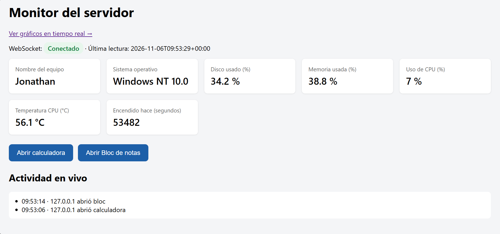
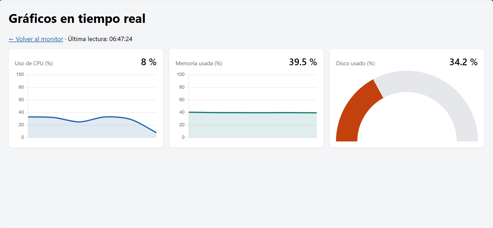

# Monitor de servidor en tiempo real

Aplicación Laravel que muestra las métricas del servidor (CPU, memoria, disco y temperatura) en tiempo real mediante WebSocket con Laravel Reverb, además de gráficos con Chart.js.

## Capturas

| Monitor del servidor | Gráficos en tiempo real |
| --- | --- |
|  |  |

## Preguntas del trabajo práctico

¿Por qué la temperatura suele aparecer como “No disponibleˮ en Windows? Prueben abrir la terminal
como administrador y comparen.

Porque windows restringe de forma nativa el acceso directo a los sensores de hardware al menos que se ejecuten como administrador.

¿Por qué el script de PowerShell nunca debe incluir datos que vengan del usuario?

porque pueden tener un riesgo critico de seguridad como la inyección de comandos.

¿Qué riesgo tiene dejar 
/api/metrics
 sin autenticación en un servidor real?

Es muy riesgoso, como exponer informacion importante del ordenador y otras informaciones como la infraestructura.

Con polling cada 5 segundos, ¿cuántos pedidos por minuto recibe el servidor si hay 50 personas
mirando?

recibe una aproximacion de 10 pedidos por segundo.

Si una app solo necesita la temperatura, ¿qué datos recibe de más al llamar a 
Criterios de evaluación
Criterio
/api/metrics 
?

Los datos que recibe de más son 
"hostname": "Jonathan",
  "os": "Windows NT 10.0",
  "php": "8.5.11",
  "disk": {
    "total_gb": 285,
    "free_gb": 195.7,
    "used_pct": 31.3
  },
  "memory": {
    "total_mb": 40590,
    "available_mb": 29308,
    "used_pct": 27.8
  },
  "cpu_pct": 32,
  "uptime_s": 6168,

## Trabajo práctico 2

¿Qué diferencia ven en la pestaña Red entre el TP 1 (polling) y este TP?

La diferencia princial probiene de que el polling realiza multiples peticiones en segundos y en este trabajo se obserban como va mostrando el rendimiento en tiempo real.

¿Qué pasa con la vista si detienen reverb:start ? ¿Y si detienen schedule:work ?

Al detener reverb:start deja de mandar a la vista actualizaciones en tiempo real y tambien si se detiene schedule:work se pierde los datos y queda frizzado en el lugar en donde quedo actualizado.

¿Por qué PowerShell se ejecuta la misma cantidad de veces con 1 o con 30 personas mirando?

powershell no se ejecuta por cada usuario al interactuar con webshocket si no con cada persona que lo este mirando por pantalla, esto sucede porque reverb envia resultados a todos los clientes conectados.

¿Por qué DemoController usa una lista blanca en lugar de recibir el nombre del programa desde el
navegador?

Al utilizar DemoController en blanco, lo estamos haciendo en forma segura para evitar riesgo de inyeccionnes o el acceso de herramientas utiles de windows.

¿Qué diferencia hay entre ShouldBroadcast y ShouldBroadcastNow ?

ShouldBroadcast se utiliza para eventos pesados como mejorar el rendimiento en produccion a diferencia de ShouldBroadcastNow es utilizado para pruebas como eventos chicos, demos etc.

¿Por qué la vista de gráficos no necesitó ningún cambio en el servidor? ¿Qué ventaja tiene haber usado un
componente?

La vista de gráficos no requirió cambios en el servidor porque el backend continuó enviando los mismos eventos y datos. La diferencia estuvo únicamente en la presentación dentro del navegador.La ventaja de esto fue el permitir encapsular la lógica del gráfico, facilitando la reutilización, el mantenimiento y la modificación de la interfaz sin afectar al código del servidor.
